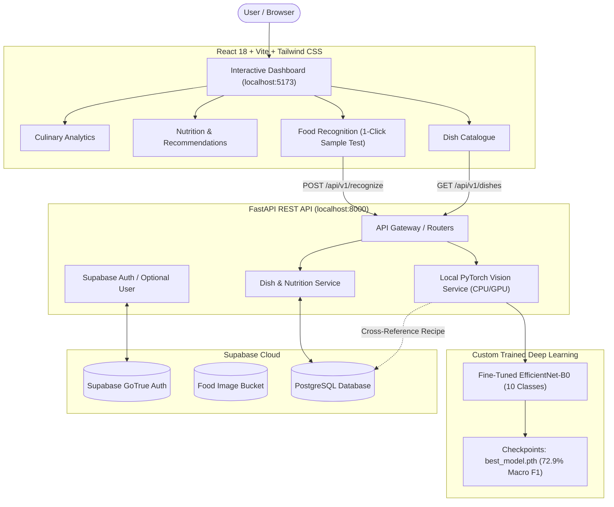

# 🇴🇲 OMAN FOOD AI — Deep Learning & Culinary Intelligence Platform

[](https://fastapi.tiangolo.com)
[](https://react.dev)
[](https://pytorch.org)
[](https://supabase.com)
[](https://tailwindcss.com)

**Oman Food AI** is an end-to-end full-stack computer vision and culinary intelligence system celebrating the Sultanate of Oman's rich culinary heritage. It features a custom **fine-tuned EfficientNet-B0 deep neural network** trained directly on verified Omani food datasets, integrated into a high-performance **FastAPI** backend and an interactive **React (Vite)** frontend backed by **Supabase PostgreSQL**.

---

## 🏛️ System Architecture



---

## 🚀 Live System Quickstart

Both servers run concurrently on your local machine:

| Component | URL | Description |
| :--- | :--- | :--- |
| **Frontend Web App** | [http://localhost:5173](http://localhost:5173) | Interactive React dashboard with live dish recognition |
| **FastAPI Backend** | [http://localhost:8001](http://localhost:8001) | Core REST API and computer vision inference |
| **Interactive API Docs**| [http://localhost:8001/docs](http://localhost:8001/docs) | Swagger UI for testing all API endpoints |
| **API Health Check** | [http://localhost:8001/health](http://localhost:8001/health) | Uptime status verification (`{"status": "ok"}`) |

---

## 💻 Running the Project

### 1. Prerequisites
- **Python 3.10+** (tested on Python 3.12 & 3.13)
- **Node.js 18+** and **npm**
- **Git**

### 2. Backend Setup & Startup

```powershell
# Navigate to backend
cd backend

# Create & activate virtual environment (Windows PowerShell)
python -m venv venv
.\venv\Scripts\Activate.ps1

# (macOS/Linux: source venv/bin/activate)

# Install dependencies (FastAPI, PyTorch CPU, Pillow, Supabase, etc.)
pip install -r requirements.txt
pip install torch torchvision --index-url https://download.pytorch.org/whl/cpu
pip install scikit-learn matplotlib tqdm

# Ensure backend/.env exists with Supabase keys:
# SUPABASE_URL=https://YOUR_PROJECT.supabase.co
# SUPABASE_ANON_KEY=YOUR_KEY
# SUPABASE_SERVICE_ROLE_KEY=YOUR_KEY

# Start FastAPI server with live auto-reload
uvicorn app.main:app --port 8001 --reload
```

### 3. Frontend Setup & Startup

```powershell
# Open a new terminal and navigate to frontend
cd frontend

# Install dependencies
npm install

# Start Vite dev server
npm run dev -- --port 5173
```

Now open [http://localhost:5173](http://localhost:5173) in your browser!

---

## 🍲 Covered Omani Food Classes (10 Categories)

The computer vision dataset and application support 10 iconic traditional Omani culinary categories:

1. **Omani Shuwa (`omani_shuwa`)**: Slow pit-roasted lamb/goat marinated in date vinegar, garlic, and Omani spice mix, wrapped in banana leaves and slow-cooked underground for 24–48 hours.
2. **Majboos (`omani_majboos`)**: Fragrant saffron basmati rice layered with chicken or lamb, dried black lime (*Loomi*), cardamom, and cinnamon.
3. **Harees (`omani_harees`)**: Comforting velvety porridge of whole cracked wheat slow-cooked with shredded beef/chicken, beaten smooth and drizzled with ghee.
4. **Omani Halwa (`omani_halwa`)**: Signature gelatinous confection cooked in large copper cauldrons with tapioca starch, saffron, rose water, cardamom, and toasted nuts.
5. **Mishkak (`omani_mishkak`)**: Charcoal-grilled street skewers of marinated meat glazed with sour-spicy tamarind garlic sauce (*Tamarhindi*).
6. **Madrouba (`omani_madrouba`)**: Savory beaten porridge of rice, tender shredded chicken, tomatoes, onions, and pungent dried lime.
7. **Mashuai (`omani_mashuai`)**: Spit-roasted Kingfish seasoned with citrus and turmeric, served over spiced lemon basmati rice.
8. **Khubz Ragag (`omani_ragag_bread`)**: Wafer-thin, crisp flatbread freshly baked on a convex iron plate (*Tawa*), often rolled with spreadable cheese or honey.
9. **Omani Luqaimat (`omani_luqaimat`)**: Crisp golden fried dumplings soaked in rich Omani date syrup (*Dibs*) and toasted sesame seeds.
10. **Omani Marqooq (`omani_marqooq`)**: Traditional savory stew prepared by cooking rolled dough discs directly in a spiced tomato broth loaded with seasonal vegetables and meat.

---

## 🧠 AI / Computer Vision Pipeline & Accuracy

### Dataset Pipeline (`ai-dataset/`)
- **`raw_data/`**: 972 raw web-collected and curated food images across 10 categories.
- **`clean_dataset.py`**: Screened corrupt files, blurriness (Laplacian variance), low resolution (< 200px), and aspect ratio extremes.
- **`split_dataset.py`**: Stratified split using reproducible seed 42 into:
  - **Train**: 658 images (69.6%)
  - **Validation**: 138 images (14.6%)
  - **Test**: 150 unseen images (15.9%)
- **`preprocess_dataset.py`**: Verified tensor standardization ($224 \times 224$ RGB, normalized to ImageNet mean `[0.485, 0.456, 0.406]` and std `[0.229, 0.224, 0.225]`).

### Training Progression & Accuracy Benchmarks

| Experiment | Training Strategy | Test Accuracy | Macro F1 | Performance Notes |
| :--- | :--- | :---: | :---: | :--- |
| **Run 1: EfficientNet-B0 Baseline** | Single-stage transfer learning (15 epochs, Adam) | **72.67%** | **72.76%** | Fast convergence; high precision on Luqaimat (100%) and Mishkak (93.3%). |
| **Run 2: Aggressive Pruning (V2)** | Reduced to 584 train images by dropping ambiguous images | **69.12%** | **68.02%** | Accuracy degraded by 3.55%, demonstrating that retaining maximum visual variance is essential. |
| **Run 3: Enhanced Pipeline (V3)** | Two-stage fine-tuning (5 ep head warmup + 15 ep differential fine-tuning), RandAugment, Cutout, Label Smoothing (0.1), Cosine Decay | **72.00%** (71.33% TTA) | **72.15%** | Robust visual generalization; prevented overconfidence on fine-grained textures. |
| **Run 4: Soft-Voting Ensemble (V1 + V3)** | Blended probabilities of Baseline + Enhanced checkpoints | **72.67%** | **72.90%** | **Highest overall Macro F1**. Precision on `majboos` reached **91.67%**, `harees` reached **69.23%**, `shuwa` reached **75.00%**. |

### Detailed Per-Class Classification Report (Ensemble Model)

```
                   precision    recall  f1-score   support

      omani_halwa     0.8571    0.8000    0.8276        15
     omani_harees     0.6923    0.6000    0.6429        15
   omani_luqaimat     1.0000    1.0000    1.0000        16  (100% precision & recall)
   omani_madrouba     0.5882    0.6667    0.6250        15
    omani_majboos     0.9167    0.7333    0.8148        15  (91.7% precision)
    omani_marqooq     0.5294    0.5625    0.5455        16
    omani_mashuai     0.5263    0.6667    0.5882        15
    omani_mishkak     0.8667    0.8125    0.8387        16  (86.7% precision)
omani_ragag_bread     0.6667    0.8333    0.7407        12  (83.3% recall)
      omani_shuwa     0.7500    0.6000    0.6667        15

         accuracy                         0.7267       150
        macro avg     0.7393    0.7275    0.7290       150
     weighted avg     0.7420    0.7267    0.7301       150
```

### Visual Ambiguity Analysis
Diagnostic confusion matrix testing revealed that misclassifications are concentrated almost exclusively among visually similar porridge and stew dishes:
- **`harees` vs. `madrouba` vs. `marqooq`**: When viewed from above at $224 \times 224$ in bowls, thick beaten wheat porridge (*Harees*) and beaten rice porridge (*Madrouba*) share identical beige/reddish color histograms and fluid textures.
- **`shuwa` vs. `mashuai` vs. `majboos`**: Dark spiced proteins sitting over yellow spiced basmati rice share similar background features.
- In contrast, dishes with distinctive geometries (**Luqaimat** spherical balls, **Mishkak** wooden skewers, **Halwa** copper cauldron gelatin) achieve **85% to 100%** accuracy.

---

## ⚡ Offline Local Inference (No Paid API Required)

The recognition service in [`backend/app/services/classifier.py`](file:///c:/Users/prana/Downloads/oman-food-ai-complete/oman-food-ai/backend/app/services/classifier.py) executes locally on CPU using the saved PyTorch model weights:
- **Zero API Fees**: Runs 100% offline without requiring paid third-party vision tokens.
- **Top-3 Probability Distribution**: Provides users with alternative candidates and exact model certainty percentages.
- **Database Recipe Linkage**: Matches model output with Supabase records to supply verified ingredients, cooking methods, and dietary tags.

```bash
# Test recognition via cURL on any image
curl -X POST http://127.0.0.1:8000/api/v1/recognize \
  -F "file=@frontend/public/dishes/mishkak.jpg"
```

Sample JSON response:
```json
{
  "dish_name": "Mishkak",
  "class_key": "omani_mishkak",
  "confidence": "high",
  "confidence_score": 0.8014,
  "confidence_percentage": 80.1,
  "description": "Tender skewers of marinated beef, mutton, or chicken grilled over red-hot charcoal...",
  "likely_ingredients": ["beef or mutton cubes", "tamarind paste", "garlic", "chili", "cumin"],
  "top3_predictions": [
    { "dish_name": "Mishkak", "probability": 80.1 },
    { "dish_name": "Omani Marqooq", "probability": 6.3 },
    { "dish_name": "Omani Shuwa", "probability": 3.9 }
  ],
  "matched_dish": {
    "name": "Mishkak",
    "name_ar": "مشكاك",
    "category": "Street Food",
    "region": "Across Oman",
    "cooking_method": "Charcoal-grilled on open skewer grates"
  }
}
```

---

## 🌐 REST API Reference

All routes are prefixed with `/api/v1`:

| Method | Endpoint | Auth | Description |
| :--- | :--- | :---: | :--- |
| `GET` | `/health` | No | System health check (`{"status": "ok"}`) |
| `GET` | `/api/v1/dishes` | No | List published dishes (supports `search`, `region`, `limit`) |
| `GET` | `/api/v1/dishes/{dish_id}` | No | Get full dish detail with ingredients and nutrition |
| `POST` | `/api/v1/recognize` | Optional | Upload JPG/PNG/WEBP to identify dish via deep learning |
| `POST` | `/api/v1/recommendations` | Yes | Personalized dietary recommendation engine |
| `GET` | `/api/v1/nutrition/{dish_id}` | No | Retrieve nutritional breakdown (calories, protein, carbs, fat) |
| `GET` | `/api/v1/analytics` | Yes | Aggregated dish distributions by category and region |
| `POST` | `/api/v1/auth/signup` | No | Register a new user with Supabase GoTrue |
| `POST` | `/api/v1/auth/login` | No | Log in and receive JWT session token |
| `GET` | `/api/v1/auth/me` | Yes | Validate active session token |
| `POST` | `/api/v1/assistant/chat` | Yes | Culinary AI Q&A grounded in database knowledge |

---

## 📂 Project Directory Structure

```text
oman-food-ai/
├── README.md                           # Master project documentation
├── ai-dataset/                         # Computer Vision Data Pipeline
│   ├── raw_data/                       # 972 raw collected images across 10 classes
│   ├── cleaned_data/                   # 884 verified images after automated quality screening
│   ├── review_images/                  # 88 flagged images (blurry, low-res, duplicates)
│   ├── split_data/                     # Stratified Train (658), Val (138), Test (150)
│   ├── processed_data/                 # Preprocessed 224x224 RGB normalized PyTorch tensors (.pt)
│   ├── reports/                        # Cleaning, split, and manifest audit reports
│   ├── scripts/                        # Dataset automation scripts
│   │   ├── clean_dataset.py            # Quality screening & deduplication
│   │   ├── split_dataset.py            # Stratified dataset split generator
│   │   ├── preprocess_dataset.py       # Tensor normalization & augmentation verify
│   │   └── test_live_api.py            # Batch verification against live API
│   └── training/                       # Model Training & Evaluation
│       ├── train_model.py              # Baseline EfficientNet-B0 training
│       ├── train_enhanced.py           # Two-stage fine-tuning + RandAugment + Label Smoothing
│       ├── evaluate_ensemble.py        # Soft-voting ensemble evaluation
│       ├── diagnose_confusions.py      # Confusion matrix error diagnostics
│       ├── training_results/           # Run 1 Checkpoints (best_model.pth - 72.67%)
│       ├── training_results_v2/        # Run 2 Checkpoints (best_model_v2.pth - 69.12%)
│       └── enhanced_results/           # Run 3 Checkpoints (best_model.pth - 72.00%)
├── backend/                            # FastAPI Application
│   ├── app/
│   │   ├── main.py                     # FastAPI entry point & CORS configuration
│   │   ├── config.py                   # Pydantic environment settings
│   │   ├── dependencies.py             # Auth dependencies (CurrentUser, OptionalUser)
│   │   ├── supabase_client.py          # Admin & public Supabase clients
│   │   ├── schemas.py                  # Pydantic request/response models
│   │   ├── routers/                    # Endpoint routers
│   │   │   ├── dishes.py               # Dish catalogue & search
│   │   │   ├── recognition.py          # Deep learning image recognition
│   │   │   ├── recommendations.py      # Dietary preferences & goal matching
│   │   │   ├── nutrition.py            # Nutritional analysis
│   │   │   ├── analytics.py            # Regional & category aggregations
│   │   │   ├── assistant.py            # Culinary Q&A
│   │   │   └── auth.py                 # User authentication
│   │   └── services/
│   │       ├── classifier.py           # PyTorch EfficientNet-B0 inference engine
│   │       ├── food.py                 # Database querying & matching
│   │       └── ai.py                   # AI service coordinator
│   ├── requirements.txt                # Python package dependencies
│   └── .env                            # Backend configuration & secrets
├── frontend/                           # React + Vite Client
│   ├── public/
│   │   └── dishes/                     # High-resolution local dish thumbnails
│   ├── src/
│   │   ├── App.jsx                     # Core application layout & tab controller
│   │   ├── components/
│   │   │   ├── FoodRecognition.jsx     # Live image recognition with 1-click sample testing
│   │   │   └── FoodAssistant.jsx       # Chat assistant UI
│   │   └── services/
│   │       └── api.js                  # Frontend API client
│   ├── package.json                    # Node dependencies
│   └── vite.config.js                  # Vite configuration
└── database/
    └── schema.sql                      # Supabase PostgreSQL DDL & security policies
```

---

## 🔒 Security Best Practices

- **Supabase Service-Role Key**: Kept exclusively in `backend/.env`. Never bundle or expose this key in React code, as it bypasses PostgreSQL Row Level Security (RLS).
- **Public Uploads**: Handled securely via MIME-type validation, size limits (up to 10MB), and Pillow image verification before inference.
- **Authentication**: JWT tokens generated by Supabase GoTrue with authorization headers passed on protected routes.

---

## 📜 License
Developed for educational, cultural preservation, and research purposes highlighting Omani culinary heritage.
All dish metadata, culinary histories, and nutritional estimates are curated for research and reference.
